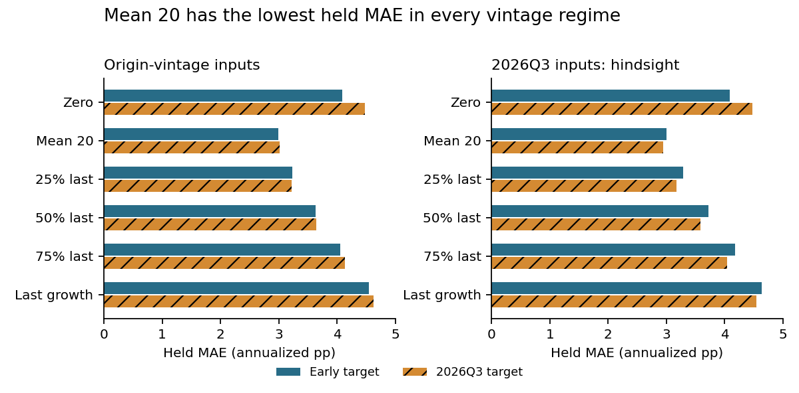

# Evaluate GDP forecasts with the data available then

A forecast backtest can change when revised inputs replace the information available at the forecast origin, or when later GDP estimates replace the early target. This study separates those two choices so a reviewer can tell what a score means.

**Finding:** the development-selected 50% mean/latest-growth blend does not beat the plain 20-quarter mean on the 42 eligible held quarters. With origin-vintage inputs and early targets, MAE is **3.629 versus 2.987 annualized percentage points**. Replacing the target with 2026Q3 GDP changes these scores to **3.641 and 3.012**. It does not reverse their ordering. Across all six rules, target revisions reverse one pairwise ordering under hindsight inputs and none under origin-vintage inputs; the leading rule remains the same.

**Practical use:** require an input-vintage identifier, an evaluation-target vintage and a complete forecast export when reviewing a macroeconomic backtest. Compare target-only and input-only changes separately. Keep simple baselines visible, including when they outperform the development choice.

Read the [six-page manuscript](paper/manuscript.pdf), [protocol and source-precision correction](PROTOCOL.md), [data rights](DATA_RIGHTS.md), [every prediction](results/held_predictions.csv), [fixed development choices](results/selection.json) and [independent held verification](results/independent_held.json).

## Reproduce

Use Python 3.12, install `requirements.txt`, then run `python src/reproduce.py`. The offline replay uses a temporary local Git clone, rebuilds source eligibility and predictions, compares all result exports and runs 23 finite synthetic boundary fixtures. It makes no new source requests and preserves original exported files. Run `python src/verify_figures.py` and `python src/verify_paper.py` for artifact checks. Linux CI additionally verifies the reviewed canonical Git blobs.

The source is the Philadelphia Fed Real-Time Data Set for Macroeconomists, with 2,323 selected factual cells from 102 quarterly vintages. The source workbooks were captured once; private-original OOXML reconciliation checked all selected cells and vintage endpoints. Public replay checks the attributed minimal projections, not an independent re-download of the raw workbooks.

## What this can establish

This is a corrected source-interpretation retrospective benchmark: 48 development quarters, eight unscored separation quarters, and 42 of 44 planned held quarters. Two documented government-shutdown timing exceptions are excluded before collection. Mid-quarter snapshot availability is documented; exact-day access is unknown. Revised inputs deliberately use hindsight. The 2026Q3 target is a later estimate, not final truth. The separate First series agrees at its observed four-decimal stored precision; the original higher-precision check failed and is documented.

All six deterministic rules, four vintage regimes, annual summaries and three fixed eras remain exported. Pandemic extremes are retained. No new estimator, trading return, significance result, deployment or business benefit is claimed. The manuscript is an independent program paper and has not been peer reviewed. Formal-publication projects are excluded.
